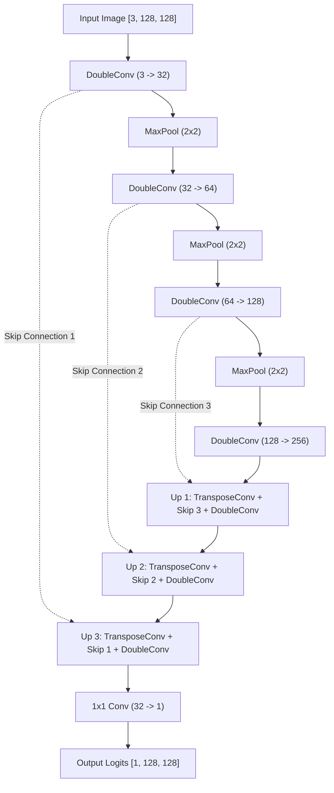

# 🎨 U-Net Semantic Segmentation in PyTorch (Colored Squares Tutorial)

This repository is a hands-on, step-by-step learning guide for semantic image segmentation using **U-Net** in **PyTorch**. It translates the classic TensorFlow/Keras toy problem—segmenting synthetic colored squares—into idiomatic, modular PyTorch.

---

## 📑 Table of Contents
1. [Why the Colored Squares Problem?](#-why-the-colored-squares-problem)
2. [Project Setup & Python Path](#-project-setup--python-path)
3. [U-Net Architecture Breakdown](#-u-net-architecture-breakdown)
4. [TensorFlow vs. PyTorch: Key Differences](#-tensorflow-vs-pytorch-key-differences)
5. [Quickstart (Run in 30 Seconds)](#-quickstart-run-in-30-seconds)
6. [Step-by-Step Code Walkthrough](#-step-by-step-code-walkthrough)
7. [Visualizing Predictions](#-visualizing-predictions)
8. [Next Steps & Experiments](#-next-steps--experiments)

---

## 🎯 Why the Colored Squares Problem?

When first learning image segmentation, real-world datasets (like medical CT scans or autonomous vehicle street scenes) can be overwhelming:
- Large file sizes (tens of gigabytes).
- Long download and preprocessing times.
- Fuzzy, ambiguous boundaries and noisy labels.

Generating **synthetic colored squares** solves all of these:
- **Zero download:** Generated dynamically using NumPy.
- **Instant training:** Achieves $>0.98$ Dice coefficient in under 1 minute on CPU.
- **Mathematical ground truth:** Every pixel's membership is unambiguous, making it the perfect sandbox to inspect how U-Net skip connections preserve sharp spatial boundaries.

---

## 🛠 Project Setup & Python Path

This repository is structured following modern Python packaging practices:

```
unet-seg-learning/
├── .venv/                   # Python virtual environment (torch, torchvision, matplotlib)
├── .vscode/                 # IDE workspace configuration
│   └── settings.json        # Auto-configures interpreter & PYTHONPATH for VS Code
├── src/
│   └── unet_seg/            # Modular Python package
│       ├── __init__.py      # Package exports
│       ├── dataset.py       # Synthetic colored squares generator & PyTorch Dataset
│       ├── model.py         # Modular U-Net implementation (DoubleConv, Down, Up)
│       ├── loss.py          # Soft Dice Loss and combined BCEDiceLoss
│       ├── train.py         # Full training loop with validation & checkpointing
│       └── visualize.py     # Inference visualization grid (Image, Mask, Heatmap)
├── tutorial.py              # Self-contained, runnable all-in-one tutorial script
├── pyproject.toml           # PEP 517/621 package specification
├── requirements.txt         # Pinned project dependencies
└── README.md                # This tutorial
```

### 1. Activating the Environment
The repository comes with a configured virtual environment `.venv`:
```bash
source .venv/bin/activate
```

### 2. Python Path Resolution
Because `src/` is registered in `pyproject.toml` and installed in editable mode (`pip install -e .`), you can import `unet_seg` from any script or directory without modifying `sys.path`:
```python
from unet_seg.model import UNet
from unet_seg.dataset import ColoredSquaresDataset
```
In addition, `.env` and `.vscode/settings.json` are pre-configured with `PYTHONPATH=src`.

---

## 🧠 U-Net Architecture Breakdown

Introduced by Ronneberger et al. (2015), U-Net consists of an **Encoder (Contracting Path)** to extract semantic context and a **Decoder (Expanding Path)** to recover fine spatial localization.



### Why Skip Connections Matter
- In regular classification CNNs, spatial pooling discards exact pixel coordinates to become position-invariant.
- In semantic segmentation, we need exact pixel locations.
- **Skip connections** copy the high-resolution feature maps from early encoder layers directly across to the corresponding decoder layers, giving the decoder both global context ("what") and sharp localized details ("where").

---

## 🔄 TensorFlow vs. PyTorch: Key Differences

If you are coming from TensorFlow/Keras, here are the most critical differences to remember:

| Concept | TensorFlow / Keras | PyTorch |
| :--- | :--- | :--- |
| **Tensor Layout** | `[Batch, Height, Width, Channels]` (`NHWC`) | `[Batch, Channels, Height, Width]` (`NCHW`) |
| **Model Structure** | Functional API (`c1 = Conv2D(...)(x)`) | Subclass `nn.Module` with `__init__` and `forward()` |
| **Skip Concatenation** | `layers.concatenate([up, skip], axis=-1)` | `torch.cat([skip, up], dim=1)` |
| **Output Activation** | `Conv2D(1, 1, activation='sigmoid')` | Return **raw logits**; use `BCEWithLogitsLoss` |
| **Training Loop** | `model.fit(X, y, epochs=10)` | Explicit loop: `optimizer.zero_grad()`, `loss.backward()`, `optimizer.step()` |
| **Dataset API** | `tf.data.Dataset` / NumPy arrays | Subclass `torch.utils.data.Dataset` + `DataLoader` |

---

## ⚡ Quickstart (Run in 30 Seconds)

To run the complete interactive tutorial from start to finish:
```bash
source .venv/bin/activate
python tutorial.py
```

This will:
1. Generate the synthetic dataset.
2. Initialize and verify the U-Net tensor shapes.
3. Train for 5 epochs.
4. Save predictions visualization to `output/tutorial_results.png`.
5. Save model checkpoint to `checkpoints/best_unet.pth`.

---

## 📖 Step-by-Step Code Walkthrough

### Step 1: Synthetic Dataset Generator
In [dataset.py](file:///home/eldo/Git/unet-seg-learning/src/unet_seg/dataset.py), we generate random rectangles with random RGB colors on a dark background:

```python
import numpy as np
import torch
from torch.utils.data import Dataset

def generate_single_sample(img_size=128):
    image = np.zeros((img_size, img_size, 3), dtype=np.float32)
    mask = np.zeros((img_size, img_size), dtype=np.float32)

    num_squares = np.random.randint(1, 4)
    for _ in range(num_squares):
        size = np.random.randint(15, 35)
        x = np.random.randint(0, img_size - size)
        y = np.random.randint(0, img_size - size)
        color = np.random.uniform(0.3, 1.0, size=(3,))

        image[y:y+size, x:x+size] = color
        mask[y:y+size, x:x+size] = 1.0

    return image, mask
```

Notice the conversion from NumPy `(H, W, C)` to PyTorch `(C, H, W)`:
```python
img_tensor = torch.from_numpy(image).permute(2, 0, 1)  # [3, 128, 128]
mask_tensor = torch.from_numpy(mask).unsqueeze(0)      # [1, 128, 128]
```

---

### Step 2: Building the U-Net Building Blocks
In [model.py](file:///home/eldo/Git/unet-seg-learning/src/unet_seg/model.py):

#### The Double Convolution Block:
```python
class DoubleConv(nn.Module):
    def __init__(self, in_channels, out_channels):
        super().__init__()
        self.double_conv = nn.Sequential(
            nn.Conv2d(in_channels, out_channels, kernel_size=3, padding=1, bias=False),
            nn.BatchNorm2d(out_channels),
            nn.ReLU(inplace=True),
            nn.Conv2d(out_channels, out_channels, kernel_size=3, padding=1, bias=False),
            nn.BatchNorm2d(out_channels),
            nn.ReLU(inplace=True),
        )

    def forward(self, x):
        return self.double_conv(x)
```

#### The Decoder Block with Skip Concatenation:
```python
class Up(nn.Module):
    def __init__(self, in_channels, out_channels):
        super().__init__()
        self.up = nn.ConvTranspose2d(in_channels, in_channels // 2, kernel_size=2, stride=2)
        self.conv = DoubleConv(in_channels, out_channels)

    def forward(self, x, skip):
        x = self.up(x)
        # Concatenate along channel dimension (dim=1)
        x = torch.cat([skip, x], dim=1)
        return self.conv(x)
```

---

### Step 3: Combined Loss (BCE + Soft Dice)
In [loss.py](file:///home/eldo/Git/unet-seg-learning/src/unet_seg/loss.py):
- **BCEWithLogitsLoss:** Evaluates pixel classification confidence smoothly.
- **DiceLoss:** Directly penalizes poor intersection-over-union region overlap.

$$\mathcal{L} = 0.5 \times \text{BCE} + 0.5 \times (1 - \text{Dice})$$

---

### Step 4: Training & Validation Loop
In [train.py](file:///home/eldo/Git/unet-seg-learning/src/unet_seg/train.py):
```bash
python -m unet_seg.train --epochs 5 --batch-size 16 --lr 0.001
```

Typical output:
```text
 Epoch  |  Train Loss  |   Val Loss   |  Val Dice  |  Val IoU  
-----------------------------------------------------------------
   1    |    0.2814    |    0.1520    |   0.8412   |   0.7329  (3.1s)
   2    |    0.0983    |    0.0762    |   0.9385   |   0.8841  (3.1s)
   3    |    0.0451    |    0.0389    |   0.9710   |   0.9436  (3.1s)
   4    |    0.0274    |    0.0241    |   0.9824   |   0.9654  (3.0s)
   5    |    0.0195    |    0.0182    |   0.9871   |   0.9745  (3.0s)
```

---

## 📊 Visualizing Predictions

After training, test the model on brand-new synthetic samples and plot the visual output:
```bash
python -m unet_seg.visualize --checkpoint checkpoints/best_unet.pth --num-samples 5
```

The output image `output/predictions.png` displays:
1. **Input Image (RGB):** The colored squares on black background.
2. **Ground Truth Mask:** The exact geometric mask.
3. **Predicted Heatmap:** The sigmoid probability values $[0.0, 1.0]$.
4. **Binary Mask:** The final segmented output thresholded at $0.5$.

---

## 🚀 Next Steps & Experiments

1. **Multi-Class Segmentation:** Extend `num_classes=4` in `ColoredSquaresDataset` to segment Red squares (Class 1), Green squares (Class 2), and Blue squares (Class 3) using `nn.CrossEntropyLoss`.
2. **Add Noise / Complex Shapes:** Introduce random circles, triangles, or background noise patterns to see how U-Net handles complex distractor boundaries.
3. **Try Different Backbones:** Replace the plain `DoubleConv` encoder with a pre-trained ResNet-34 or EfficientNet encoder using `torchvision.models`.
